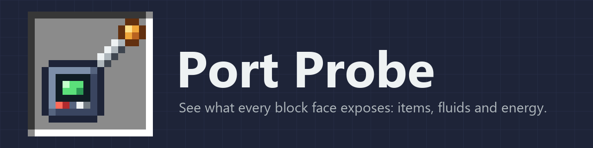
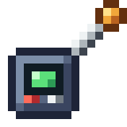
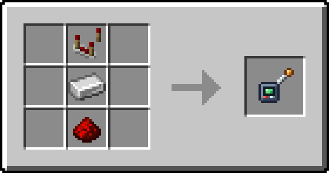

<p align="center">
  
</p>

<p align="center">
  <b>A handheld probe for tech packs.</b> Right-click any block face to see which item, fluid and energy
  ports it exposes on that side.<br>
  <sub>Minecraft 26.1.2 · NeoForge · <a href="#versions">other versions</a></sub>
</p>

<p align="center">
  <a href="https://www.curseforge.com/minecraft/mc-mods/port-probe"><b>Download on CurseForge</b></a>
</p>

---



Ever had a pipe that refuses to connect, or a machine that will not take items from the side you hooked up?
Port Probe answers the question "what does this face of this block actually accept?"

- **Per-face readout.** Items, fluids and energy, for exactly the face you clicked.
- **Works with any mod.** Ports that other mods add (chemicals, heat, network connections and so on) are listed by name.
- **All-sides summary.** Sneak and click to compare every side at once.
- **Slot by slot.** Shows what each reachable slot holds and whether it works as an input, an output or both.
- **Acceptance test.** Automatically checks which of the items and fluids you are carrying the face would take. No setup needed.
- **Never opens the GUI.** The probe reads the block instead of activating it.
- **Read-only.** Every check is a simulation. Nothing is inserted, extracted or changed.

## Versions

There is a build of Port Probe for each of these Minecraft versions. Each one lives on its own branch.

| Minecraft | NeoForge | Made for | Branch |
|---|---|---|---|
| 1.21.1 | 21.1 | All the Mods 10 | [`main`](https://github.com/stereoabuse/port-probe/tree/main) |
| 26.1.2 | 26.1 | All the Mods 11 | [`26.1`](https://github.com/stereoabuse/port-probe/tree/26.1) |

## Pages

- [Using the probe](#using-the-probe)
- [Reading the output](#reading-the-output)
- [Crafting](#crafting)
- [What it can and cannot see](#what-it-can-and-cannot-see)
- [For developers](#for-developers)

---

## Using the probe

| Action | What you get |
|---|---|
| **Right-click** a block face | Full readout for that face |
| **Sneak + right-click** a block | One line per side, plus the unsided view |

The readout is printed to your chat. Only you see it.

The acceptance test uses whatever you have on you: hotbar, off hand and the rest of your inventory. To find out whether a face takes a certain item or fluid, just have it (or a bucket of it) somewhere in your inventory when you click.

## Reading the output

Right-clicking the side of a furnace while carrying coal, oak logs and cobblestone:

```
Port Probe: Furnace (north)
Items: 1 slot(s), 0 occupied, extractable now: no
  Slot 1: empty (in)
  Accepts: Coal, Oak Log
Fluids: not exposed
Energy: not exposed
```

The side of a furnace reaches the fuel slot, so only the fuels are accepted. The top reaches the input slot, which took everything that was tried:

```
Port Probe: Furnace (up)
Items: 1 slot(s), 0 occupied, extractable now: no
  Slot 1: empty (in)
  Accepts: all tested items
Fluids: not exposed
Energy: not exposed
```

Sneak + right-clicking the same furnace:

```
Port Probe: Furnace (all sides)
  down: items
  up: items
  north: items
  south: items
  west: items
  east: items
  unsided: items
```

| Line | Meaning |
|---|---|
| **Items** | How many slots this face can reach, how many hold something, and whether anything can be pulled out right now. |
| **Slot N** | What the slot holds and its role, see below. Up to 6 slots are listed. Blocks with more slots than that list only the occupied ones. |
| **Fluids** | How many tanks this face can reach and whether anything can be drained right now. Tanks are listed with their contents and capacity in mB, with the same limit of 6 as slots. |
| **Energy** | Stored and maximum FE, and whether this face can receive or give energy right now. A full store reads as not receiving, an empty one as not extracting. |
| **Other** | Every other kind of port the face offers, by the ID its mod gave it, for example `mekanism:chemical_handler`. Only shown when there is one. The all-sides summary lists these too. |
| **Accepts** | Which items or fluids this face would take, see below. |
| **not exposed** | The block offers nothing of that kind on this face. A pipe on this side will not connect for it. |
| **too many to scan** | The face reaches more than 4096 slots. Only the slot count is reported, because scanning that many could lag the server. Fluids and energy are still shown. |
| **exposed, not read** | The face offers items, but the container is locked or is a loot chest nobody has opened yet, so the probe leaves its contents alone. |
| **unsided** | What the block offers to things that ask without naming a side, such as some wireless or internal connections. |

### Slot roles

| Role | Meaning |
|---|---|
| **in** | Something can be inserted into this slot. |
| **out** | The slot's contents can be extracted. |
| **in/out** | Both. |
| **no input** | An empty slot that accepted nothing that was tried. Often an output slot that has not produced anything yet. |
| **locked** | The slot holds something that can neither be extracted nor added to right now. |

### The Accepts line

For items, the probe tries one of every distinct item you carry (hotbar first), plus a few built-in sample items so it works with an empty inventory.

| Accepts | Meaning |
|---|---|
| **all tested items** | Everything that was tried is accepted. The face is probably not filtered, but only the items tried are certain. |
| A list of names | The items you carry that this face takes. At most 6 are named, then "+N more". |
| **some items, but none that you carry** | The face is filtered: it took a sample item but nothing in your inventory. |
| **nothing right now (no empty slot)** | Every slot is occupied, so nothing can be told about what it would accept. |
| **nothing you carry** | Nothing that was tried is accepted. The face may be output-only. |

For fluids, the probe tries water, lava and the contents of any buckets or tanks you carry, and names the ones the face would take.

Everything describes the current moment. An empty output slot cannot be recognised as an output until the machine produces something, and a full slot can look like one that accepts nothing.

Items inside backpacks or other containers you carry are not tried.

---

## Crafting

<table>
  <tr>
    <td align="center"><br><b>Port Probe</b><br>Redstone comparator, iron ingot and redstone dust in a column</td>
  </tr>
</table>

The column can be placed in any of the three columns of the crafting grid.

---

## What it can and cannot see

Port Probe reads the three standard NeoForge capabilities, which almost every tech mod uses for pipes and cables, and lists any other capability a face offers:

| Kind | Seen |
|---|---|
| Items | yes, with contents |
| Fluids | yes, with contents |
| Energy (FE) | yes, with amounts |
| Other mods' capabilities (Mekanism chemicals and heat, AE2 network connections, etc.) | by name only: the probe shows that the port exists, not what is in it |
| Things that are not capabilities (Create rotation, redstone, etc.) | no |

Blocks made of multiple parts in one block space, such as cables with attached buses, are read as a whole block. The probe does not distinguish individual parts.

---

## For developers

### Building

Requires a JDK 25.

```bash
./gradlew build
```

The jar is written to `build/libs/`.

### Regenerating the pictures

The item texture and every picture in this README are generated by scripts, run with [uv](https://docs.astral.sh/uv/):

| Script | Output |
|---|---|
| `uv run tools/make_texture.py` | The 16x16 item texture, from a pixel map inside the script |
| `uv run tools/make_docs_images.py` | `docs/images/`: item icons, one picture per crafting recipe, and the banner |

`make_docs_images.py` reads the recipe JSON files in `src/main/resources/data/portprobe/recipe/`, so a new recipe gets its picture by running the script again. It takes vanilla item textures from the Minecraft client jar that Gradle caches, so run a Gradle build once first.

### Recipes

The recipe is a normal datapack recipe at `data/portprobe/recipe/port_probe.json` and can be replaced or removed like any other.

## License

[MIT](LICENSE). You may use Port Probe in modpacks and reuse its code.
